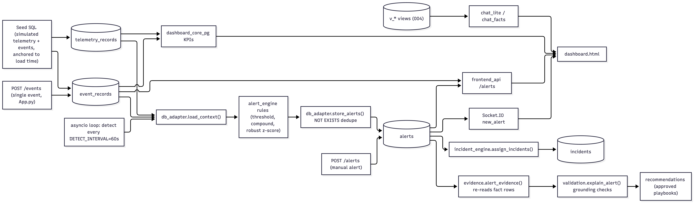
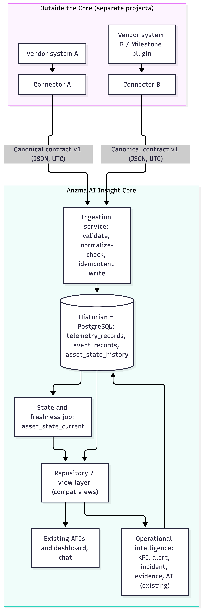

# CORE_DATA_ARCHITECTURE.md — Anzma AI Insight Core

| | |
|---|---|
| **Document** | Week 3 / Day 1 — Data Architecture & Core Reliability |
| **Status** | Proposal for review. Nothing in sections 6–10 is implemented. |
| **Source of truth** | The uploaded archive `Anzma-Platform-Clean.zip` (local snapshot, including local modifications), inspected read-only. No GitHub access was used. |
| **Related** | `CANONICAL_DATA_MODEL.md`, `HISTORIAN_DESIGN.md`, `DATA_MIGRATION_PLAN.md`, `SPRINT_1_TECHNICAL_ISSUES.md` |

Conventions used in all five documents:

- **[Verified]** — read directly in code/SQL in the archive (file path given).
- **[Proposed]** — design recommendation; does not exist today.
- **[Assumption]** / **[Open]** — needs confirmation (see section 13).
- Findings are by code reading. No SQL, test or service was executed against a database for this review.

> **Current database authority:** this Day 1 review is a historical analysis. For the agreed runtime schema and migration order, use [DATABASE_BASELINE.md](DATABASE_BASELINE.md). The working tree keeps the bootstrap schema at `db/init/` and versioned migrations at `db/migrations/`.

---

## 1. Executive summary

Anzma AI Insight today is a single-database, simulated-data application. Its **authoritative runtime model** is a 13-table PostgreSQL schema plus 5 views, created by four files loaded in this order (see `docker-compose.yml`, `db` service):

1. `db/init/anzma_schema_and_seed.sql` — 12 tables + seed.
2. `db/migrations/003_incidents.sql` — `incidents` table and `alerts.incident_id`.
3. `db/migrations/004_chat_views.sql` — 5 read-only views (`v_data_clock`, `v_asset_overview`, `v_incident_overview`, `v_alert_overview`, `v_camera_status`).
4. `db/migrations/005_alert_uniqueness.sql` — unique alert key used by `store_alerts`.

The existing intelligence (KPI engine, alert engine, incident engine, evidence verification, grounding validation, chat assistant) is coherent and tested (`TEST_RESULTS_DAY2.txt`: 43/43 integration checks; `TEST_RESULTS_CHAT_CONSISTENCY.txt`: 31/31). **It should be preserved, not rewritten.**

What stands between this code base and a reusable, vendor-independent Core:

| # | Gap | Evidence (short) |
|---|---|---|
| 1 | **No ingestion path exists for telemetry.** Only `POST /events` (single event) and `POST /alerts` exist. The batch API in `docs/API_CONTRACT.md` is documented as not implemented in `README.md`. | `App.py` routes |
| 2 | **No building identity on operational records.** `telemetry_records`, `event_records`, `alerts`, `incidents` carry no `building_id`; building is derived by joining through `assets → locations`. No customer/organization concept. | schema SQL |
| 3 | **No observed-vs-received time, source, or quality** on facts. | `telemetry_records`, `event_records` columns |
| 4 | **Equipment state and data freshness are conflated.** `no_data` is a member of the health-status enum. “Now” is the latest stored record, so a dead feed looks current. | `dashboard_core_pg.py`, `004_chat_views.sql` |
| 5 | **Unit mismatch silently disables alert rules.** `bandwidth_util` is stored in `%`; thresholds/labels are in Mbps. | `alert_config.py`, seed |
| 6 | **Hardcoded local assumptions**: UTC+2 offset, 08–18 working hours, zone name `'Server Room'`. | `alert_config.py`, `alert_engine.py`, `chat_lite.py` |
| 7 | **Three competing “authoritative” data-model documents** (22-table draft in `data-model.sql`/`DATA_MODEL.md`/`ERD-new.png`, proposed `/api/v1` in `docs/`, and the real 13-table runtime). | see §5 |
| 8 | **Duplicated business logic** for asset health (4 implementations) and fault/recovery pairs (3). | see §5 |

**Proposed direction (simplest reliable path):** keep PostgreSQL and the existing table names; evolve them **additively** (nullable columns, new small tables, compatibility views); introduce a canonical JSON contract at the Core boundary; add a thin ingestion service and a state/freshness layer; then consolidate duplicated SQL behind one repository layer with parity tests. No new infrastructure (no TimescaleDB, Kafka, Redis).

---

## 2. Existing architecture overview

```
Anzma-Platform-Clean/
├── App.py                       FastAPI app + Socket.IO; background detection loop (asyncio)
├── app/
│   ├── dashboard_core_pg.py     KPI engine (8 KPIs), psycopg v3, filters, timestamp parsing
│   ├── frontend_api.py          /dashboard/overview|trends|equipment-health, /alerts, /alerts/{id}
│   ├── chat_facts.py            deterministic chat facts (LOCAL CHANGE – staged)
│   └── chat_lite.py             /chat router, LLM tool "run read-only SQL" (LOCAL CHANGE – staged)
├── day2_ahmed/
│   ├── alert_engine.py, alert_config.py   rules, thresholds, playbooks
│   ├── incident_engine.py                 alert → incident grouping + lifecycle
│   ├── evidence.py, validation.py         evidence re-verification, grounding checks
│   ├── recommendations.py, ai_explainer.py playbook recommendations, Ollama phrasing + fallback
│   ├── db_adapter.py, integrity_rules.py  DB access + enum translation; compatibility rules
│   ├── pipeline.py                        detect() / explain_alert() / explain_incident()
│   └── migrations/003_incidents.sql, 004_chat_views.sql, 005_alert_uniqueness.sql
├── db/init/anzma_schema_and_seed.sql      authoritative schema + seed (docker init)
├── static/                      dashboard.html, chat widget
├── docker-compose.yml           db (postgres:16), ollama, ollama-init, api
└── LEGACY / DOCS-ONLY: chat_engine.py, chat_api.py, dashboard_api.py (old schema, unused),
    data-model.sql, DATA_MODEL.md, ERD-new.png, docs/ARCHITECTURE.md, docs/API_CONTRACT.md
```

---

## 3. Current runtime data flow



Key behaviours [Verified]:

- **Facts enter only via seed SQL and `POST /events`.** `grep` for `INSERT INTO telemetry_records` finds it only in `test_frontend_api.py` and the seed. `POST /events` validates asset, event type, and per-system compatibility (`event_type_system_compat`), rejects timestamps more than 5 minutes in the future, and relies on `ON CONFLICT (asset_id, event_type_id, ts) DO NOTHING` (returns 409 on a duplicate).
- **“Now” is data-relative.** `pipeline.detect()` uses `db_adapter.latest_ts()` = `GREATEST(max telemetry ts, max event ts)`; KPI windows (`frontend_api._window`) and `v_data_clock` do the same. Documented as intentional (`DAY2_AHMED_HANDOVER.md`, limitation 8).
- **Detection runs inside the API process** (`App.py`, `_alert_loop`, every `DETECT_INTERVAL` seconds, default 60) and on demand via `POST /alerts/run`. Alert de-duplication is a `WHERE NOT EXISTS (rule_id, asset_id, first_ts)` in `db_adapter.store_alerts()` — **there is no unique constraint behind it**.
- **Incident lifecycle** is driven only through `POST /incidents/{id}/status` (`incident_engine.set_status`: open → acknowledged → resolved, resolved is final). Status changes cascade to the incident's alerts. No endpoint changes a single alert's status.
- **AI**: Ollama phrases explanations; the deterministic fallback is built from the same stored evidence; every final text is grounding-checked (`validation.py`). Recommendations come only from approved playbooks (`alert_config.PLAYBOOKS`), never from the model.

---

## 4. Existing database architecture

### 4.1 Tables (authoritative runtime) [Verified: `db/init/anzma_schema_and_seed.sql`, `003_incidents.sql`]

| Table | Key columns / constraints | Notes |
|---|---|---|
| `buildings` | `building_id` PK; `name` UNIQUE | Seed: Main Tower (1), Data Center Annex (2) |
| `locations` | `location_id` PK; `building_id` FK; `floor`; `name`; UNIQUE `(building_id, name)` | Used as “zone” everywhere |
| `system_types` | `system_type_id` PK; `code` UNIQUE with `CHECK code IN ('HVAC','NETWORKING','ACCESS_CONTROL','CCTV','FIRE_ALARM')` | Adding a system requires altering the CHECK |
| `assets` | `asset_id` PK; `asset_code` UNIQUE; `name`; `asset_type` (free text); `system_type_id` FK; `location_id` FK | No manufacturer/model/serial/external id/parent/status columns |
| `metric_types` | `metric_id` PK; `name` UNIQUE; `unit` | 8 metrics (temperature °C as `'C'`, humidity, power_kw, cpu_load, packet_loss, bandwidth_util `'%'`, smoke_level, camera_fps) |
| `event_types` | `event_type_id` PK; `name` UNIQUE | 12 types incl. `heartbeat` |
| `metric_type_system_compat`, `event_type_system_compat` | composite PK, FKs | Which metric/event is valid for which system. **Not enforced on INSERT** (comment in schema file and `integrity_rules.py`) |
| `telemetry_records` | `telemetry_id` PK; `asset_id`, `metric_id` FKs; `ts TIMESTAMPTZ`; `value DOUBLE PRECISION` (finite CHECK); UNIQUE `(asset_id, metric_id, ts)` | No source, quality, received time, building |
| `event_records` | `event_id` PK; `asset_id`, `event_type_id` FKs; `ts`; `severity` (info/warning/critical); `details JSONB`; UNIQUE `(asset_id, event_type_id, ts)` | Device-reported severity; heartbeats stored here |
| `alerts` | `alert_id` PK; `rule_id`; `detection_method` (threshold/anomaly/compound); `severity`; `asset_id` FK; `first_ts`,`last_ts`,`detected_ts`; `evidence JSONB NOT NULL`; `status` (open/acknowledged/resolved); `resolved_ts`; `explanation JSONB`; `explanation_source` (ollama/fallback); `incident_id` FK (003) | CHECKs: `last_ts >= first_ts`; resolved ⇔ `resolved_ts` set |
| `incidents` (003) | `incident_id` PK; `location_id` FK; `title`; `severity`; `status`; `grouping_rule`; `first_ts`,`last_ts`; `acknowledged_ts`,`resolved_ts` | Same CHECKs as alerts |
| `scenario_runs` | arrays of ids (no FKs possible) | Test harness in the `public` schema. No reference found in any `.py` file |

All timestamps are `TIMESTAMPTZ`. Indexes: `idx_assets_location`, `idx_assets_system_type`, `idx_telemetry_ts`, `idx_event_ts`, `idx_event_asset_ts`, `idx_alerts_first_ts`, `idx_alerts_asset_ts`, `idx_alerts_severity`, `idx_alerts_open` (partial), `idx_alerts_incident`, `idx_incidents_location_last`, `idx_incidents_status`, plus the UNIQUE-backed indexes.

### 4.2 Views (004, untracked) [Verified]

`v_data_clock`, `v_asset_overview` (24 h health per asset), `v_incident_overview`, `v_alert_overview`, `v_camera_status`. These exist for the chat assistant (`chat_lite.py` lists them in its system prompt) and are the first example of a **compatibility/read layer** — the pattern this proposal extends.

### 4.3 Seed characteristics relevant to design

The seed (`generate_series` every 15 minutes for 78 h, hourly heartbeats, 15 injected events) is anchored to `now()` at load (`seed_anchor`). Values follow a sine curve of the epoch, so **absolute values and warning-vs-critical peaks differ between loads** (handover limitation 2). Consequence for testing: regression comparisons must be made on **the same database before and after a change**, not across rebuilds (see `DATA_MIGRATION_PLAN.md` §9).

---

## 5. Identified inconsistencies and dependencies

Priority: P0 critical reliability/integrity · P1 required for productization foundation · P2 important · P3 future.
“Impact” = potential effect on existing functionality if fixed.

### 5.1 Findings table

| ID | File / object | Current behaviour | Problem | Recommendation | Pri | Impact if changed |
|---|---|---|---|---|---|---|
| F-01 | `App.py` (`create_event`, `create_alert`); `docs/ARCHITECTURE.md` §Ingestion; `README.md` “API contract mismatch” | Only single-event and manual-alert endpoints exist. Docs describe atomic 1–5000-record batch ingestion that no code implements. The rules “UTC ends with Z”, “no future timestamp”, “1..5000 atomic batch” are cited in a seed comment as “enforced in ingestion code” — no such code was found. | Core cannot receive connector data; telemetry cannot enter at all outside SQL. | Add an ingestion service implementing the canonical contract (`CANONICAL_DATA_MODEL.md` §16) over the existing tables. | P1 | None for existing endpoints (additive) |
| F-02 | `db/init/anzma_schema_and_seed.sql` (`telemetry_records`, `event_records`) | No `building_id`, `source`, `quality`, `received_at`. | Observed time is indistinguishable from receive time; no provenance; building only derivable by joins. | Additive nullable columns + backfill (`DATA_MIGRATION_PLAN.md` M1–M2). | P1 | None if additive |
| F-03 | `alerts`, `incidents`; `dashboard_core_pg.SCOPE_CTE`; `frontend_api.create_router`; `004_chat_views.sql` | KPI summary supports `building_id`; the page endpoints (`/dashboard/overview`, `/trends`, `/equipment-health`), `/alerts`, `/incidents`, `open_incidents` KPI, `v_data_clock` are **global**. `frontend_api` passes `"building": None`. `db_adapter.load_context` loads all assets of all buildings. No customer/organization table. | Multi-building behaviour is incomplete and untested; a second customer would see the first customer’s data (including through the chat SQL tool). | Add `building_id` to alerts/incidents/facts; make every repository function take a building scope; add `organizations` (single default row initially). | P1 | Default scope = “all buildings” keeps today’s numbers |
| F-04 | `db_adapter.SYSTEM_TO_API`, `frontend_api.SYSTEM_TO_UI`/`SYSTEM_FROM_UI`, `reference_data.SYSTEM_CODES` | DB: `NETWORKING`, `ACCESS_CONTROL`, lower-case enums; engine/API: `NETWORK`, `ACCESS`, upper-case; `locations.name` ⇒ “zone”. Translation maps duplicated in two modules (+ `chat_facts.SYSTEM_WORDS`). | Three vocabularies; drift risk. | Canonical codes = DB codes; keep one translation module at the API edge. | P2 | Presentation only |
| F-05 | `alert_config.T` (`bandwidth_warn=900.0`, `bandwidth_crit_mean=980.0`), `db_adapter.METRIC_MAP`, `integrity_rules.EVENT_CATALOG`, seed `metric_types` | `bandwidth_util` is `%` in the DB; rules, alert text and facts (`bw_mean_mbps`) use Mbps. `METRIC_MAP` labels it `%`, `EVENT_CATALOG` says `Mbps`. Temperature: DB `'C'` vs engine `'°C'`. | `NET_BANDWIDTH_HIGH` and `NET_BANDWIDTH_ANOMALY` cannot fire; the `NET_LOSS` cause split (`bw_mean_mbps > 900`) always selects `LINK_QUALITY`. Acknowledged in `DAY2_AHMED_HANDOVER.md` (limitation 3) and `README.md`. No unit-normalisation layer exists. | Decide the canonical unit for utilisation (**[Open]** — % vs Mbps), register units in `metric_types`, re-base thresholds. | P0 | **Changes results** (new network alerts will appear) — requires explicit approval and a regression baseline |
| F-06 | `alert_engine.py` (`rule_hvac_filter`, `rule_cctv`, `rule_fire`), `db_adapter.EVENT_MAP` | Rules read event types `FILTER_FAULT`, `MOTION_DETECTED`, `BATTERY_LOW`, `PANEL_HEARTBEAT`, `ACCESS_GRANTED`, and detail keys `fan_on`, `mains_ok`, `battery_pct`. `EVENT_MAP` maps only 9 of the 12 seeded event types; none of those names exist in seed `event_types`. | `HVAC_FILTER_FAULT`, `CCTV_AFTER_HOURS_MOTION`, `FIRE_BATTERY_LOW` and several playbook causes (`FAN_FAILURE`, `FILTER_BLOCKAGE`, `MAINS_LOSS`) cannot trigger on current data. `SEC_BLIND_SPOT_ACCESS` needs a camera and reader in the same location while the camera is offline; the seed has no such scenario. | Not a bug to “fix” now: document as dormant; make event/metric catalogue data-driven so connectors can supply them. | P2 | None |
| F-07 | `dashboard_core_pg._asset_status_counts`, `frontend_api.equipment_health` (inline SQL), `004_chat_views.sql` `v_asset_overview`, `chat_facts._conditions/_status` | Asset health is implemented four times. `v_asset_overview` uses a 24 h window `(as_of-24h, as_of]` and counts **any** critical event as `critical`; the KPI logic excludes recovered paired faults (`FAULT_RECOVERY_PAIRS`) and uses `[start, end)`. | Same word (“critical”) can differ by code path; consistency today depends on the test suite (`test_chat_consistency.py`, 31 checks) and on the chat using KPI functions for status. (By code reading; not executed.) | One health definition in one repository/view, parity-tested against current outputs. | P2 | Possible small number changes in chat answers that use `v_asset_overview`; must be reconciled explicitly |
| F-08 | `dashboard_core_pg.FAULT_RECOVERY_PAIRS`, `integrity_rules.CLOSERS`, `v_camera_status` | Opener/closer pairs defined three times; `hvac_fault`/`hvac_recovered` appear in the KPI pairs but are unmapped in the alert engine. | Duplicated rule data. | Put `resolves_event_type_id` and `event_class` on `event_types` (idea already present in the repo’s draft `data-model.sql`). | P2 | None if parity-tested |
| F-09 | `integrity_rules.EVENT_CATALOG` vs `event_type_system_compat` / `metric_type_system_compat` | The same “what is valid for which system” knowledge is in Python and in SQL. DB does not enforce it on INSERT. | Duplicated and unenforced. | Single source = DB tables (+ validation in the ingestion service). | P2 | None |
| F-10 | `dashboard_core_pg` KPIs `alerts_raised`, `critical_alerts`, `alert_rate_per_hour` | These count **`event_records`** with severity warning/critical, not rows of `alerts`. The UI labels them “Alerts raised”. | Two meanings of “alert” (device event with severity vs. engine-detected alert). Conflicts with the Event / Alert / Incident distinction required for the product. | Keep KPI values unchanged for compatibility; rename the concept in the canonical model (`events_with_severity` vs `alerts`) and add separate alert-based KPIs later. | P2 | KPI semantics must not change silently |
| F-11 | `alert_config.LOCAL_UTC_OFFSET = 2`, `WORK_START=8`, `WORK_END=18`; `alert_engine.local_hour/is_occupied` | Fixed offset and hours for all buildings; `buildings` and `locations` carry no timezone or schedule. | Wrong for other sites; fixed offset ignores DST; “after hours” facts (`ACC_DOOR_FORCED`, `ACC_DENIAL_SPIKE`, `SEC_BLIND_SPOT_ACCESS`, anomaly regimes) depend on it. | `buildings.timezone` (IANA) + working hours (idea already in the repo’s draft schema); compute local hour per building. | P1 | Results change only if the chosen zone differs from fixed UTC+2 (e.g., DST periods) — **[Open]** |
| F-12 | `alert_engine.py:179,347`; `chat_lite.py:566` | `zone == "Server Room"` selects stricter thresholds and the motion rule; playbook action `HVAC_IT_NOTIFY` conditions on the same string. | Behaviour keyed on a display name. | `locations.zone_type` / `is_sensitive` columns. | P2 | Backfill `zone_type` for “Server Room” keeps results identical |
| F-13 | `system_types.code CHECK (...)`, `reference_data.SYSTEM_CODES`, `v_camera_status` (`asset_type='camera'`), `dashboard_core_pg` metric-name constants | Adding a building system requires a DDL change and code edits. | Violates “future building systems without code changes”. | Drop the CHECK in favour of catalogue rows; read system list from the DB. | P2 | None |
| F-14 | `db_adapter.store_alerts` | Idempotency by `NOT EXISTS` only; three writers can run concurrently (background loop, `POST /alerts/run`, `POST /alerts`); no `UNIQUE (rule_id, asset_id, first_ts)`. | Duplicate alerts → duplicate incidents under concurrency or multi-worker deployment. | Unique index (after duplicate pre-check) + `INSERT … ON CONFLICT DO NOTHING`; advisory lock for the detection loop. | P0 | None for correct data |
| F-15 | `event_records` UNIQUE `(asset_id, event_type_id, ts)` | Two distinct events of the same type on the same asset at the same timestamp collapse (second is dropped/409). | Silent loss of legitimate events from real devices. | Add `source_id` + `source_event_id` dedupe key for connector events; keep the old key for legacy rows. | P1 | None for existing rows |
| F-16 | `alert_engine.make_alert` (`detected_ts`) | For threshold rules `detected_ts` is the **first data timestamp of the run**, not processing time; `created_at` is processing time. | Misleading semantics for latency/SLAs. | Document; add `detected_at` (processing time) in canonical alert, keep `detected_ts` for compatibility. | P2 | None |
| F-17 | `alert_engine.py` (`load_context`, `store_alerts` after `run_engine`) | Legacy functions refer to tables `systems`, `events`, `locations.zone` that do not exist in the runtime schema; legacy `store_alerts` runs `DELETE FROM alerts …`. `run_engine` correctly uses `db_adapter`. | Dead but dangerous code. | Remove after tests confirm no callers. | P2 | None |
| F-18 | `dashboard_api.py`, `chat_engine.py`, `chat_api.py` | Query `events`, `systems`, etc. (old schema). Not mounted by `App.py`; `README.md` says unused. A search of all `.py` files found imports only among the legacy files themselves (`chat_api.py` → `chat_engine.py`); no active module or test imports them. | Confusing duplicates of logic. | Archive/remove in the consolidation phase. | P2 | None |
| F-19 | `data-model.sql`, `DATA_MODEL.md`, `ERD-new.png`, `day2_ahmed/NEW-ERD.png`, `docs/ARCHITECTURE.md`, `docs/API_CONTRACT.md` | Describe a 22-table “unified” schema (`telemetry`, `events`, `asset_state`, `alert_rules`, `evidence`, …) and a `/api/v1` API. `DATA_MODEL.md` cites `migrations/001_unified_schema.sql`, which does not exist; the Day 2 handover states it was removed (decision D2). | “One authoritative model” is not obvious from the repository. | Mark these as superseded drafts; this document set becomes the reference. Reuse their good ideas (timezone, `zone_type`, `resolves_event_type_id`, `asset_state`, `evidence`) rather than their table names. | P1 | None (docs) |
| F-20 | `db/init/` vs `day2_ahmed/` copies of schema; `docker-compose.yml` init mounts | Two identical copies of the schema file. Init scripts run only on an **empty** volume; no migration runner or `schema_migrations` table. `004` is untracked while compose (staged) mounts it. | Existing deployments cannot be upgraded; a fresh clone of the tracked tree would lack the mounted file. | Versioned migration runner; commit `004` with the compose change (by the owner of those changes). | P0 | Deployment procedure |
| F-21 | `dashboard_core_pg.open_readonly`; `App.day2_connect`; `db_adapter.connect` | Three connection factories, two drivers (psycopg v3 and psycopg2). `open_readonly` is not actually read-only (comment only); default passwords `"change-me"` / `""`. No pooling. | Hygiene and security; per-request connections. | One connection module; genuine read-only role for read paths; env-required credentials. | P2 | None |
| F-22 | `chat_lite._safe_sql`, `_run_readonly_sql` | LLM tool runs model-written SQL on the app connection (`SET TRANSACTION READ ONLY`, 5 s timeout, string blocklist, `LIMIT 200`). Unscoped by building. | String blocklist is brittle (false positives/negatives); no tenant scoping; uses the application user. | Dedicated read-only DB role + building-scoped views before multi-customer use. | P1 | Chat must keep answering from `v_*` views |
| F-23 | `dashboard_core_pg` `heartbeat_compliance`; `alert_config.T['reading_gap_min']` | Hourly heartbeat and 15-minute cadence are global constants (`expected_slots = seconds // 3600 + 1`; `reading_gap_min=20`). | No per-asset expected interval; cannot represent assets that report every 5 s or every 6 h. | `reporting_expectations` per asset/metric. | P1 | KPI formula must still return the same value for current assets |
| F-24 | KPI `healthy_assets_pct` status enum (`critical`, `no_data`, `warning`, `unknown`, `normal`) | Silence (`no_data`) is a *health status*; `frontend_api` maps it to `WARNING`. | Equipment state and data freshness are mixed; a silent device is reported as unhealthy rather than “state unknown, data stale”. | Separate `operational_state` from `freshness` (`CANONICAL_DATA_MODEL.md` §8–9); keep the KPI’s existing output as a compatibility projection. | P1 | KPI output unchanged by design |
| F-25 | `telemetry_records`, `event_records` | Mutable (no append-only trigger); evidence references facts by id inside JSONB; FKs from alerts to facts do not exist. | Evidence integrity relies on re-verification at read time (which exists and is tested). | Normalised `alert_evidence` rows with FKs; keep JSON in `alerts.evidence` (dual-write). | P1 | None if dual-written |
| F-26 | `event_records` heartbeats (`event_types.name='heartbeat'`) | ≈ 950 heartbeat rows in the 78 h seed mixed with operational events; every consumer filters them out (`NOT_COUNTED_EVENTS`, KPI, chat). | Liveness mixed with operational history. | Keep as events for compatibility; add `last_seen_at` in `asset_state_current` so liveness does not require scanning events. | P2 | None |
| F-27 | Repository root | `.env` is present in the archive (git-ignored, not tracked; contents deliberately not read). Port 5432 published, no authentication, Socket.IO `cors_allowed_origins="*"` (`README.md` lists these). | Secret-handling and exposure risks if the archive is shared. | Exclude `.env` from hand-off archives; require auth before any non-demo deployment. | P2 | None |
| F-28 | `scenario_runs` (public schema) | Evaluation ground truth lives next to production tables; array columns have no FKs. | Mixed concerns. | Move to an `eval` schema (idea present in the repo’s draft). | P3 | None |

### 5.2 Coverage of the 12 requested finding categories

| Category | Findings |
|---|---|
| 1 Duplicate/overlapping structures | F-07, F-08, F-09, F-19, F-20 |
| 2 Naming inconsistencies | F-04, F-10 |
| 3 Duplicated business logic | F-07, F-08, F-09 |
| 4 Missing relationships/constraints | F-14, F-15, F-25, F-13 |
| 5 Timestamps/timezones | F-02, F-11, F-16 |
| 6 Missing building/tenant relationships | F-03 |
| 7 Hardcoded identifiers | F-11, F-12, F-13 |
| 8 Dependence on simulated data | F-05, F-06, §4.3 (anchor to `now()`), F-26 |
| 9 Vendor-specific assumptions | none inside the Core schema; `badge → card_id` rename in `db_adapter.DETAIL_RENAME` and port naming (`Gi1/0/24`) in seed `details` are the only traces. Gap is the *absence* of manufacturer/model/external-id fields (F-02, §7). |
| 10 Integrity/reliability risks | F-14, F-15, F-20, F-22, F-25 |
| 11 Components to reuse | §5.3 |
| 12 Components to consolidate | §5.4 |

### 5.3 Reuse (do not rewrite)

`alert_engine.py` rule functions and `alert_config.py` playbooks · `incident_engine.py` (grouping, lifecycle, ranking) · `evidence.py` (row re-verification) · `validation.py` (grounding contract) · `recommendations.py` · `ai_explainer.py` fallback logic · `db_adapter.guard/DatabaseUnavailable` · `dashboard_core_pg` KPI definitions and timestamp parser · the `004` views pattern · the existing test suites (§11).

### 5.4 Consolidate (later, behind parity tests)

Asset-health SQL (4 copies) · fault/recovery pairs (3 copies) · system-code translation (3 copies) · connection factories (3) · event/metric compatibility (Python + SQL) · legacy root modules · competing model documents.

---

## 6. Proposed target architecture [Proposed]



Principles applied: reuse existing tables and engines; add, don’t replace; a repository/view layer is the only thing engines read through; no new infrastructure.

## 7. Separation between Core, connectors, and plugins [Proposed]

| Concern | Core | Connector / plugin |
|---|---|---|
| Vendor protocol, SDK, auth to the vendor system | — | ✔ |
| Mapping vendor IDs → `external_id`; vendor payload → canonical fields | — | ✔ |
| **Unit conversion to the canonical unit** | validates (rejects unknown/mismatched unit) | ✔ converts |
| Timestamps converted to UTC, `observed_at` taken from the device/source | validates format/range, stamps `received_at` | ✔ |
| Store-and-forward buffering, retry with the same `message_id` | accepts retries idempotently | ✔ |
| Schema/contract validation, compatibility checks, dedupe, persistence | ✔ | — |
| State derivation, freshness, gaps, alerts, incidents, KPIs, AI | ✔ | — |
| Asset registry (internal ID, location) | ✔ owner | may *propose* assets via a provisioning call (later) |
| Vendor-specific fields | stored only in `source_metadata` / `asset.metadata` JSONB, never as columns | ✔ source |

The Core must not import any vendor SDK and must not branch on vendor name. The only vendor-shaped data it keeps is opaque metadata.

## 8. Multi-building design [Proposed]

- **Ownership:** `organizations (1) → buildings (n) → locations (tree) → assets`. Isolation key for every operational record is **`building_id`**; `organization_id` lives only on `buildings`. Single-customer installs run with one default organization — no multi-tenancy machinery beyond the foreign key.
- **Every operational row carries `building_id`** (telemetry, events, state, alerts, incidents, evidence), kept consistent with the asset’s building by a composite FK `(asset_id, building_id) → assets`.
- **All repository functions take a building scope** (`NULL` = all buildings the caller may see). Default behaviour equals today’s.
- **Per-building settings:** IANA timezone, working hours (replacing the global offset).
- **Data clock per building** (`as_of` computed per building) so one silent building cannot mask or distort another.
- Row-level security or schema-per-customer are **not** proposed now; revisit when a second customer shares a database (**[Open]** Q3).

## 9. Canonical data ownership

| Data | Owner (writes) | Readers |
|---|---|---|
| Organizations, buildings, locations, systems, assets, catalogues | Core admin/provisioning | everyone |
| `telemetry_records`, `event_records` | Ingestion service only (plus current seed/`POST /events` during transition) | engines, KPI, chat, historian queries |
| `data_sources`, `ingestion_batches`, `ingestion_rejections` | Ingestion service | operations, data-quality views |
| `asset_state_current`, `asset_state_history`, `data_gaps` | State/freshness job | KPI/dashboard/chat via views |
| `alerts`, `alert_evidence` | Alert engine (`pipeline.detect`) | everyone; status changes via incident/alert lifecycle API |
| `incidents` | Incident engine | everyone |
| `alerts.explanation` | AI explain pipeline | UI |

## 10. Authoritative runtime data model

| Layer | Definition |
|---|---|
| **Current authoritative runtime model** | `anzma_schema_and_seed.sql` + `003_incidents.sql` (+ `004_chat_views.sql`): the 13 tables and 5 views of §4. Confirmed by `docker-compose.yml` init mounts, `db_adapter.py` docstring, `DAY2_AHMED_HANDOVER.md` (decision D2), and every SQL statement in `App.py`, `app/*.py`, `day2_ahmed/*.py`. |
| **Proposed canonical target model** | The same tables, evolved additively, plus the new entities in `CANONICAL_DATA_MODEL.md`. **Not implemented.** |
| **Intermediate compatibility mechanisms** | Additive nullable columns; compatibility views keeping the old column names/semantics; the existing `db_adapter` translation layer; dual-write of evidence; feature flags on new ingestion; parity tests. |
| **Not authoritative** | `data-model.sql`, `DATA_MODEL.md`, `ERD-new.png`, `NEW-ERD.png`, `docs/ARCHITECTURE.md`, `docs/API_CONTRACT.md`, `dashboard_api.py`, `chat_engine.py`, `chat_api.py`, legacy functions in `alert_engine.py`. |

## 11. Existing intelligence compatibility

Summary (full mapping in `DATA_MIGRATION_PLAN.md` §1 and §5):

| Component | Reads today | Impact of the proposal | Adaptation |
|---|---|---|---|
| KPI engine (`dashboard_core_pg`) | `assets`, `system_types`, `locations`, `event_records`, `event_types`, `telemetry_records`, `metric_types` | None for M1–M3 (tables and columns remain). Healthy-assets output is preserved as a projection of state + freshness. | None initially; later swap SQL for repository calls with parity tests |
| Alert engine | via `db_adapter.load_context` → engine-shaped event dicts (`EVENT_MAP`, `METRIC_MAP`) | None. Quality filter (exclude `BAD`) is a no-op on existing rows (all `GOOD`). | Thresholds/units: F-05 decision; timezone/zone_type: F-11/F-12 |
| Incident engine | `alerts`, `incidents`, `assets`, `locations` | Gains `building_id`; grouping rule unchanged | None |
| Evidence validation | `alerts.evidence` JSON → re-read `event_records`/`telemetry_records` by id | Unchanged; `alert_evidence` table added in parallel | Dual-write |
| AI / recommendations | `alerts`, evidence, `alert_config.PLAYBOOKS` | Unchanged | None |
| Chat assistant | `v_*` views + KPI functions + read-only SQL tool | Views kept (names/columns stable); building scope added later | Views gain `building_id` columns (additive) |
| Dashboards | `frontend_api` endpoints | Unchanged response shapes | None |

Changes that would **alter results** (all need explicit approval): F-05 bandwidth units; F-11 timezone if the zone ≠ fixed UTC+2 in DST periods; F-07 reconciliation of `v_asset_overview` with the KPI definition.

## 12. Architecture decisions and rationale

| ID | Decision | Rationale |
|---|---|---|
| AD-01 | Keep PostgreSQL as the Historian store; no TimescaleDB/Kafka/Redis | Seed scale is ~5 k telemetry rows; design goals are correctness and traceability, not throughput. Re-evaluate on measured need (`HISTORIAN_DESIGN.md` §14). |
| AD-02 | Evolve existing tables additively; keep names | Zero breaking change for ~15 modules that hard-code the names. |
| AD-03 | `building_id` on every operational row; `organization_id` only on `buildings` | Simple, explicit isolation without RLS. |
| AD-04 | Canonical system codes = current DB codes (`NETWORKING`, `ACCESS_CONTROL`); translation to UI names stays at the API edge | They are already persisted, FK targets, and accepted by the KPI API. |
| AD-05 | Connectors convert units and timestamps; Core validates | Keeps the Core vendor-free; the rule is testable at the boundary. |
| AD-06 | State (`operational_state`, `availability`, `communication_status`) is separate from `freshness`; missing telemetry never implies offline | Required by the product brief. |
| AD-07 | “Now” = wall clock for live evaluation, explicit `as_of` for replay/demo | Allows stale-feed detection without breaking simulated-data demos. |
| AD-08 | Idempotency by natural key (existing UNIQUE) + `source_id/source_event_id` for events | Reuses what exists; fixes F-15. |
| AD-09 | Evidence: keep JSON, add normalised FK-backed `alert_evidence` (dual-write) | Preserves `evidence.py` behaviour and adds referential integrity. |
| AD-10 | No dead-letter queue service; a PostgreSQL `ingestion_rejections` table is enough initially | “Dead-letter if justified”: audit need is real, a broker is not. |
| AD-11 | No rewrite of KPI/alert/incident/AI engines | No evidence it is necessary; tests exist. |

## 13. Risks and open technical questions

**Risks**
1. Fixing F-05 (units) changes visible alert output; stakeholders must expect new network alerts.
2. Backfilling `building_id`/`received_at` on large tables must be batched; `received_at` for legacy rows is **unknown** and must stay `NULL` (do not invent).
3. Partitioning later constrains FKs to `telemetry_records` (see `HISTORIAN_DESIGN.md` §14).
4. Detection loop inside the API process will duplicate under multiple workers until F-14 is fixed.
5. Local changes (`chat_facts.py`, `chat_lite.py`, compose, `004`) are uncommitted: any migration work must be coordinated with their owner so they are not lost.

**Open questions (need eng.Mohsen / Amr)**
- **Q1** Canonical unit for `bandwidth_util`: percent utilisation or Mbps? (F-05)
- **Q2** Which IANA timezone and working hours apply to Main Tower and Data Center Annex? (F-11)
- **Q3** Is a second customer expected to share one database? (decides RLS vs schema/DB per customer)
- **Q4** Batch semantics: atomic (as in `docs/API_CONTRACT.md`, 409 on any duplicate) or per-record results? This document proposes per-record results; confirm.
- **Q5** Are “campus/site” levels needed, or is `locations.parent_location_id` sufficient?
- **Q6** Should KPI “Alerts raised” keep counting severity events, or move to `alerts`? (F-10)
- **Q7** Does `app/chat_lite.py`’s SQL tool remain, or be restricted to the views only? (F-22)
- **Q8** Ownership of playbook approvals (`DEFAULT_APPROVER` is a placeholder).
