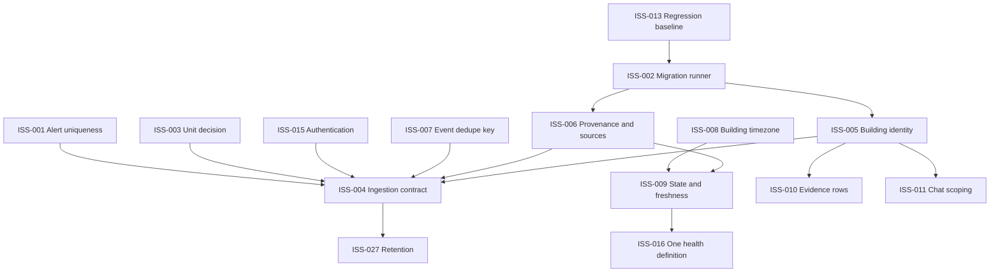

# SPRINT_1_TECHNICAL_ISSUES.md — Anzma AI Insight Core

Prioritised technical issues and dependencies derived from the Day 1 review (`CORE_DATA_ARCHITECTURE.md` findings **F-xx**), reconciled with repository/runtime inspection on 18 November 2026.
No deadlines, estimates or assignees are given: none are supported by evidence in the repository.

> **Current scope note (19 November 2026):** migrations 006–007, the advisory-locked migration runner, per-source hashed credentials, source-scoped mapping, batch API, rejection audit, quality-aware readers, and event collision fix are implemented and tested in an isolated PostgreSQL project. The shared running database remains at its pre-006 schema. Older issue descriptions below are historical unless their status explicitly says current; use `INGESTION_CONTRACT.md` and `DATA_MIGRATION_PLAN.md` for the approved implementation.

| Priority | Meaning |
|---|---|
| **P0** | Critical reliability or data-integrity risk |
| **P1** | Required for the initial productization foundation |
| **P2** | Important improvement |
| **P3** | Future enhancement |

“Phase” refers to migration phases **M0–M6** (`DATA_MIGRATION_PLAN.md` §6) and historian phases **H0–H6** (`HISTORIAN_DESIGN.md` §15).
Code references below originated in the uploaded archive. Current implementation status must be read with the scope note and linked architecture baseline; historical test results remain historical. The current offline unit baseline passed 25/25.

---

## 0. Overview

### 0.1 Blockers (must be resolved before connectors or a second building can be onboarded safely)

`ISS-001`, `ISS-002`, `ISS-003` (P0) · `ISS-004`, `ISS-005`, `ISS-006`, `ISS-007`, `ISS-013`, `ISS-015` (P1 foundation)

### 0.2 Improvements (P1/P2 — required for a stable product, not blocking first ingestion)

`ISS-008`, `ISS-009`, `ISS-010`, `ISS-011`, `ISS-012`, `ISS-014` (P1) · `ISS-016` … `ISS-026` (P2)

### 0.3 Future enhancements (P3)

`ISS-027` … `ISS-031`

### 0.4 Dependency map

### 0.5 Decisions needed (Mohsen / Amr)

| ID | Question | Blocks |
|---|---|---|
| Q1 | Canonical unit for `bandwidth_util`: % utilisation or Mbps? | **Resolved for current runtime:** `%`; no link capacity is stored. Provisional alert limits: 80% warning / 90% critical mean. Recalibrate when capacity data exists. |
| Q2 | IANA time zone and working hours for Main Tower and Data Center Annex | ISS-008 |
| Q3 | Will two customers ever share one database? (RLS vs separate DB/schema) | ISS-005, ISS-011 |
| Q4 | Batch semantics: atomic (as in `docs/API_CONTRACT.md`) or per-record results | ISS-004 |
| Q5 | Are campus/site levels needed beyond `locations.parent_location_id`? | ISS-005 |
| Q6 | Should KPI “Alerts raised” keep counting severity events? | ISS-023 |
| Q7 | Keep the chat read-only SQL tool or restrict to views | ISS-011 |
| Q8 | Who signs off playbook actions (`DEFAULT_APPROVER` placeholder)? | ISS-026 |
| Q9 | Authentication approach for connectors and API; route naming/versioning convention (`/api/v1` is only a proposal in `docs/API_CONTRACT.md`) | ISS-004, ISS-015 |
| Q10 | RPO/RTO and backup destination | ISS-012 |

---

## 1. P0 — Critical reliability / data integrity

### ISS-001 — Alert de-duplication has no database constraint
- **Priority:** P0 · **Status:** Database uniqueness implemented in migration 005; concurrent detection/incident assignment still needs a focused test. · **Phase:** M3 / H5
- **Situation / evidence:** `app/adapters/database/db_adapter.py::store_alerts` and `db/migrations/005_alert_uniqueness.sql` protect `(rule_id, asset_id, first_ts)` with a database UNIQUE index. The in-process loop in `app/main.py`, `POST /alerts/run`, and `POST /alerts` remain multiple writers; no concurrent-run lock was verified.
- **Action:** pre-check for existing duplicates (never delete silently); add `UNIQUE (rule_id, asset_id, first_ts)`; change insert to `ON CONFLICT DO NOTHING`; guard the detection loop with `pg_advisory_lock`.
- **Depends on:** ISS-002 (runner), ISS-013 (baseline).
- **Acceptance:** two concurrent `pipeline.detect()` runs produce no duplicate `(rule_id, asset_id, first_ts)`; `test_day2_integration.py` still 43/43; golden snapshot unchanged; duplicate pre-check query returns 0 rows or each duplicate has a documented resolution.

### ISS-002 — No migration runner or schema versioning
- **Priority:** P0 · **Status:** Migration 006 and runner implemented; shared DB not yet migrated. · **Phase:** M1
- **Situation / evidence:** migration 006 adds `schema_migrations`; `scripts/apply_migrations.py` applies unapplied 006+ files under an advisory lock. Fresh Compose initialization mounts migrations 006–007.
- **Action:** operator reviews backup/target and runs the documented migration command when deploying. Init mounts do not upgrade an existing volume.
- **Acceptance:** **Code/schema acceptance passed in isolated DB** (20 tables, 7 views; migration applied twice); shared DB upgrade remains a deployment action.

### ISS-003 — Bandwidth unit mismatch silently disables alert rules
- **Priority:** P0 · **Status:** code/documentation updated; regression verification passed on the current change.
- **Situation / evidence:** the database stores `bandwidth_util` as `%`; previous rule thresholds and facts used Mbps, preventing bandwidth alerts and forcing the packet-loss explanation toward link quality.
- **Change:** retain `%` as canonical (no link-capacity field exists); use provisional 80% warning, 90% critical mean, and 15 percentage-point minimum anomaly deviation. Align alert facts, summaries, playbook comparisons, and the integrity catalogue to `%`.
- **Verification:** unit/integration suites 138/138; dashboard script exit 0; S1 fallback 14/14 and live model 15/15; schema `OVERALL OK`. Seed remains 10 alerts / 8 incidents with no bandwidth-high/anomaly alert; its maximum is 72.32% and it has no sustained 15-point deviation. Synthetic 85% packet-loss selects congestion while seed's 68.6% selects link quality.
- **Remaining:** calibrate the provisional limits when link capacity/configuration data becomes available.
- **Note:** this is a result-changing fix (`DATA_MIGRATION_PLAN.md` §9.4); previous test results do not verify the current working tree.

---

## 2. P1 — Initial productization foundation

### ISS-004 — No ingestion path for the canonical contract (telemetry cannot be received)
- **Priority:** P1 · **Status:** Implemented and API tested in an isolated database. · **Phase:** M4
- **Situation / evidence:** `POST /api/v1/ingest/batches` accepts canonical telemetry/event/state records. The legacy `POST /events` and `POST /alerts` remain supported.
- **Action:** no further architecture is authorized here. Expand contract coverage only within the approved v1 semantics; deploy migration 006 separately after operator review.
- **Verification:** partial outcomes, exact batch replay, changed-payload rejection, immutable telemetry conflict, rejection retrieval, and auth were exercised. Full frontend suite has one pre-existing CRAC dashboard expectation mismatch (recorded in the implementation report).

### ISS-005 — Building (and organization) identity missing on operational records
- **Priority:** P1 · **Status:** Approved source/building scoping implemented; broader organization/building isolation remains future scope. · **Phase:** M1
- **Situation / evidence:** migration 006 adds unique nullable-safe `buildings.building_code`; each source is tied to exactly one existing building, and mappings must target assets in that building. Facts still derive building through `assets → locations`; organization and general API tenant scoping were not approved here.
- **Action:** retain the approved source-scoped boundary; any organization schema or broad dashboard isolation requires a separate decision.
- **Acceptance:** SQL trigger enforces same-building map targets; ingestion API test resolves assets within authenticated source/building context.

### ISS-006 — Facts lack provenance, observed-vs-received time, and quality
- **Priority:** P1 · **Status:** Additive nullable provenance/quality implemented; old rows remain NULL without backfill. · **Phase:** M1
- **Situation / evidence:** migration 006 adds source, receive time, quality, batch, contract and source metadata fields without changing historical facts.
- **Action:** preserve NULL legacy values; provision source/building mapping only for new connectors.
- **Acceptance:** isolated integrity test confirms existing facts remain and the new columns stay NULL; `v_telemetry_valid` excludes BAD and retains legacy NULL quality.

### ISS-007 — Event uniqueness can collapse distinct events
- **Priority:** P1 · **Status:** Resolved by migration 007 and source event identity checks. · **Phase:** M1
- **Situation / evidence:** legacy `UNIQUE (asset_id, event_type_id, ts)` prevented different source events at the same instant.
- **Change:** migration 007 drops that full unique constraint after creating its partial replacement for `source_event_id IS NULL`; the source event ID unique index from 006 handles connector records. `POST /events` chooses the matching legacy conflict target when the partial index exists and remains compatible before it does.
- **Verification:** isolated API tests accept two distinct source IDs at the same asset/type/time; reject reuse of one ID with changed details or time as `CONFLICT`; and keep duplicate legacy `POST /events` at HTTP 409. Data integrity 22/22, frontend/API 20/20, Day 2 43/43, E2E 14/14; schema verifier OVERALL OK.

### ISS-013 — No regression baseline harness for KPI/alert/incident/evidence/AI/chat
- **Priority:** P1 (blocker for every change) · **Phase:** M0 / H0
- **Situation / evidence:** tests exist (`test_day2_ahmed.py` 25, `test_day2_integration.py` 43, `test_frontend_api.py`, `test_chat_consistency.py` 31) but no before/after snapshot comparison; seed is data-relative so cross-rebuild comparison is invalid (`db/init/anzma_schema_and_seed.sql`, handover limitation 2).
- **Action:** implement the golden-snapshot capture/compare of `DATA_MIGRATION_PLAN.md` §9.2 against a restored copy; include content hashes (§10).
- **Depends on:** none (needs a restorable backup; ISS-012 provides the procedure).
- **Acceptance:** snapshot taken on a database copy, re-run on the unchanged copy yields an empty diff; deliberately altering one value on the copy is detected.

### ISS-015 — No authentication on API, database port or Socket.IO
- **Priority:** P1 (blocker before real connectors) · **Phase:** before M4 goes live
- **Situation / evidence:** `README.md` limitation “No authentication”; `deploy/compose/docker-compose.yml` publishes database/API/model ports; `app/main.py` Socket.IO currently allows all origins.
- **Action:** decide approach (Q9); authenticate connector requests and bind `source_code` to the credential; restrict CORS and DB exposure.
- **Depends on:** Q9; Amr (deployment).
- **Acceptance:** an unauthenticated ingestion request is rejected; a source cannot write for another source’s `source_code`; no secret appears in repository or docs.

### ISS-008 — Hardcoded UTC+2 and 08–18 working hours
- **Priority:** P1 · **Phase:** M5
- **Situation / evidence:** `alert_config.LOCAL_UTC_OFFSET=2`, `WORK_START=8`, `WORK_END=18`; `alert_engine.local_hour/is_occupied`. Affects `after_hours` in `ACC_DOOR_FORCED`, `ACC_DENIAL_SPIKE`, `SEC_BLIND_SPOT_ACCESS`, anomaly regimes.
- **Action:** `buildings.timezone` (validated IANA) + working hours; engine reads them per asset’s building; seed values reproduce current behaviour unless a change is approved.
- **Depends on:** ISS-005; Q2; ISS-013.
- **Acceptance:** with the zone/hours chosen to match the old constants the golden snapshot is unchanged; a building with a different zone classifies the same UTC instant differently in a unit test.

### ISS-009 — Equipment state and data freshness are conflated; no state history
- **Priority:** P1 · **Phase:** M5 / H3
- **Situation / evidence:** `no_data` is a health status (`dashboard_core_pg.STATUS_ORDER`, `_asset_status_counts`); `frontend_api.equipment_health` maps it to `WARNING`; “now” is the latest stored record (`db_adapter.latest_ts`, `v_data_clock`); `reading_gap_min=20` and hourly heartbeat are global (`alert_config.T`, `_heartbeat_compliance`); no state history table.
- **Action:** add `reporting_expectations`, `asset_state_current`, `asset_state_history`, `data_gaps` and the freshness job with the rules in `CANONICAL_DATA_MODEL.md` §8–9; LIVE vs REPLAY evaluation time; shadow-compare against KPI status counts before exposing.
- **Depends on:** ISS-005, 006, 008.
- **Acceptance:** an asset with stale telemetry but no offline event has `freshness=STALE/MISSING` and `availability` unchanged; Camera 2 scenario: KPI `no_data` count unchanged and `freshness=MISSING` reported; shadow comparison shows 0 mismatches or each is explained.

### ISS-010 — Evidence references live only inside JSONB
- **Priority:** P1 · **Phase:** M2 / H5
- **Situation / evidence:** `alerts.evidence` JSON (`alert_engine.evidence_event`: `source`, `record_id`, `event_id|telemetry_id`); `evidence.py::_verify` re-reads rows by id; no FKs.
- **Action:** add `alert_evidence` (FK-backed, `validation_status`, `snapshot`, `telemetry_ts` for future partitioning); dual-write from `store_alerts`; backfill from JSON; keep `evidence.py` reading JSON until parity proven.
- **Depends on:** ISS-005.
- **Acceptance:** per alert, `alert_evidence` row count = number of JSON events; every row resolves to an existing fact row with equal `ts`/`value`; `evidence.alert_evidence()` output unchanged for all alerts.

### ISS-011 — Chat SQL tool is unscoped and guarded by a string blocklist
- **Priority:** P1 · **Phase:** before multi-customer use
- **Situation / evidence:** `app/api/chat_lite.py::_safe_sql`, `_run_readonly_sql`: blocklist, read-only transaction, timeout and row limit; execution uses the application DB connection. The free-form tool is not building-scoped.
- **Action:** dedicated read-only DB role limited to `v_*` views; building-scoped views; decide whether the free-form tool remains (Q7); coordinate with the owner of the local changes.
- **Depends on:** ISS-005; Q3, Q7.
- **Acceptance:** the chat role cannot read base tables or write; a query under building A cannot return building B rows; `test_chat_consistency.py` still 31/31.

### ISS-012 — No backup, restore or integrity-verification procedure
- **Priority:** P1 · **Phase:** H0 / H6
- **Situation / evidence:** none found in the repository; data lives in named volume `pgdata` (`docker-compose.yml`).
- **Action:** scheduled `pg_dump` to storage outside the volume; restore runbook into a scratch DB; integrity script reusing `integrity_rules.stored_violations` and `evidence.alert_evidence`, plus counts/hashes/orphan checks (`HISTORIAN_DESIGN.md` §13).
- **Depends on:** Q10.
- **Acceptance:** restore drill into a scratch database reproduces table counts and content hashes; integrity script reports `{'telemetry': 0, 'events': 0}` and `unverified = 0`.

### ISS-014 — Competing model documents obscure the authoritative model
- **Priority:** P1 · **Phase:** documentation (no code)
- **Situation / evidence:** `docs/DATA_MODEL.md`, `docs/data-model.sql`, ERD assets, `docs/ARCHITECTURE.md` and API drafts describe schemas/routes not deployed. The current runtime authority is `db/init/anzma_schema_and_seed.sql` plus migrations 003–005, as confirmed by the live schema inspection recorded in `PRODUCTIZATION_IMPLEMENTATION_REPORT.md`.
- **Action:** after review, mark those files “superseded draft” with a pointer to this document set; reuse their ideas (timezone, `zone_type`, `resolves_event_type_id`, `asset_state`, `evidence`) as already incorporated. (Day 1 modifies none of them.)
- **Depends on:** team approval of these documents.
- **Acceptance:** each superseded file starts with a banner naming the authoritative documents; the README links `CORE_DATA_ARCHITECTURE.md` as the data-model reference.

---

## 3. P2 — Important improvements

### ISS-016 — Asset health is implemented four times
- **Priority:** P2 · **Phase:** M6
- **Evidence:** `app/repositories/dashboard_core_pg.py::_asset_status_counts`; `app/api/frontend_api.py::equipment_health`; `004_chat_views.sql::v_asset_overview`; `app/api/chat_facts.py` status functions. `v_asset_overview` uses window `(as_of−24h, as_of]` and counts any critical event, while the KPI uses `[start,end)` and excludes recovered paired faults.
- **Action:** compare outputs on current data; choose one definition; implement once (repository/view); other paths call it.
- **Depends on:** ISS-009, ISS-013.
- **Acceptance:** parity test across KPI, equipment-health, chat for every system and building; any approved difference is listed.

### ISS-017 — Fault/recovery pairs and event compatibility are duplicated
- **Priority:** P2 · **Phase:** M6
- **Evidence:** `FAULT_RECOVERY_PAIRS` (`dashboard_core_pg.py`), `CLOSERS` (`integrity_rules.py`), pair logic in `v_camera_status`; `EVENT_CATALOG` (`integrity_rules.py`) vs `event_type_system_compat`; `hvac_fault/hvac_recovered` in KPI pairs but unmapped in `db_adapter.EVENT_MAP`.
- **Action:** `event_types.event_class` + `resolves_event_type_id`; single DB source; retire Python copies.
- **Depends on:** ISS-016.
- **Acceptance:** KPI and chat results equal baseline; one definition remains.

### ISS-018 — Catalogues and zone semantics are hardcoded
- **Priority:** P2 · **Phase:** M1 / M5
- **Evidence:** `system_types.code CHECK (…)`; `reference_data.SYSTEM_CODES`; `'Server Room'` in `alert_engine.py` (rule_hvac_temp, rule_cctv) and `chat_lite.py`; `v_camera_status` uses `asset_type='camera'`.
- **Action:** drop CHECK; read systems from table; `locations.zone_type/is_sensitive`; flag the existing Server Room.
- **Depends on:** ISS-005.
- **Acceptance:** adding a system type is an `INSERT` only; identical alerts for the existing data; no `"Server Room"` literal in engine code.

### ISS-019 — Three connection factories, two drivers, weak defaults
- **Priority:** P2 · **Phase:** M6
- **Evidence:** `db_adapter.connect` (psycopg2/psycopg), `App.day2_connect` (psycopg2, default password `""`), `dashboard_core_pg.open_readonly` (psycopg v3, default password `"change-me"`, not actually read-only).
- **Action:** one connection module; read paths use a read-only role; required env credentials; optional pooling.
- **Depends on:** ISS-011.
- **Acceptance:** one factory used by all modules; read endpoints run under a role without write privileges; startup fails if credentials are missing.

### ISS-020 — Dead and legacy code
- **Priority:** P2 · **Phase:** M6
- **Evidence:** `dashboard_api.py`, `chat_engine.py`, `chat_api.py` (old schema; only imported by each other); `alert_engine.load_context`/`store_alerts(cur, alerts, start, end)` reference non-existent `systems`/`events` tables and the latter runs `DELETE FROM alerts …`; `scenario_runs` unreferenced.
- **Action:** remove after confirming no importers and tests pass.
- **Depends on:** ISS-013.
- **Acceptance:** repository search shows no references; all suites pass.

### ISS-021 — Alert timestamps and alert-level lifecycle
- **Priority:** P2 · **Phase:** M3
- **Evidence:** `alert_engine.make_alert` sets `detected_ts` to the first data timestamp for threshold rules; `created_at` is processing time; only incident-level status endpoint exists (`POST /incidents/{id}/status`); no acknowledged/resolved actor fields.
- **Action:** add `detected_at`, `acknowledged_ts/by`, `resolved_by`; define single-alert acknowledge/resolve API consistent with incident cascade.
- **Depends on:** ISS-005.
- **Acceptance:** lifecycle tests keep passing (`TEST_RESULTS_DAY2.txt` lifecycle checks); new fields populated on transitions.

### ISS-022 — Dormant rules and unmapped catalogue entries
- **Priority:** P2 · **Phase:** documentation → M4
- **Evidence:** rules needing `FILTER_FAULT`, `MOTION_DETECTED`, `BATTERY_LOW`, `PANEL_HEARTBEAT`, `ACCESS_GRANTED`, `fan_on`/`mains_ok`/`battery_pct` detail keys; seed `event_types` lacks them; `EVENT_MAP` maps 9 of 12 seeded types (`HVAC_FILTER_FAULT`, `CCTV_AFTER_HOURS_MOTION`, `FIRE_BATTERY_LOW` cannot fire).
- **Action:** document as dormant; add the types/metrics when a real source provides them; make mapping table-driven.
- **Depends on:** ISS-017.
- **Acceptance:** a rule/data-requirements table exists; adding the missing event type and a test event triggers the rule.

### ISS-023 — Two meanings of “alert”
- **Priority:** P2 · **Phase:** decision Q6
- **Evidence:** `dashboard_core_pg._alert_counts` counts `event_records` severity; `alerts` table is separate; UI label “Alerts raised” (`frontend_api.overview`).
- **Action:** keep KPI values; clarify labels/definitions; add alert-based KPIs separately if wanted.
- **Depends on:** Q6.
- **Acceptance:** KPI output unchanged; definitions text states what is counted.

### ISS-024 — Heartbeat compliance assumes hourly cadence
- **Priority:** P2 · **Phase:** M5
- **Evidence:** `_heartbeat_compliance`: `expected_slots = seconds // 3600 + 1`.
- **Action:** compute expected from `reporting_expectations`; default 3600 s reproduces current numbers.
- **Depends on:** ISS-009.
- **Acceptance:** identical KPI on current data; correct result for an asset with a different interval in a unit test.

### ISS-025 — Archive/secret hygiene and CORS
- **Priority:** P2 · **Phase:** immediate hygiene
- **Evidence:** a `.env` file was present in the uploaded ZIP (git-ignored, untracked; contents not read); `__MACOSX`, `.DS_Store`, `__pycache__` in the archive; `cors_allowed_origins="*"`.
- **Action:** exclude `.env` and OS artefacts from hand-off archives; document required variables in `.env.example` only.
- **Acceptance:** archive checklist exists; no credentials in any document.

### ISS-026 — Playbook approvals are placeholders
- **Priority:** P2 · **Phase:** content
- **Evidence:** `alert_config.DEFAULT_APPROVER`; handover limitation 6; `README.md` (only HVAC approval reported).
- **Action:** named approvers per playbook (Q8); store approval records.
- **Acceptance:** each approved action has a real approver; recommendations unchanged otherwise.

---

## 4. P3 — Future enhancements

| ID | Title | Evidence / trigger | Action | Acceptance |
|---|---|---|---|---|
| ISS-027 | Retention policy framework | None in repo (`HISTORIAN_DESIGN.md` §10) | `retention_policies` table, bounded-batch job, **disabled by default**, durations approved by business | With policy disabled nothing is deleted; enabled policy deletes only eligible rows and logs a summary |
| ISS-028 | Rollup tables (`telemetry_rollup_1h/1d`) | Add only after measured latency need (`HISTORIAN_DESIGN.md` §8) | Idempotent rollup job incl. late-data reopen | Rollup equals raw aggregate for closed buckets |
| ISS-029 | Partitioning readiness | PK/FK constraint with partitioned tables (`HISTORIAN_DESIGN.md` §14) | Keep `telemetry_ts` in `alert_evidence`; rehearse partitioned copy | Rehearsal restores and passes integrity checks |
| ISS-030 | Move `scenario_runs` to an `eval` schema | Test harness in `public` schema (F-28) | Relocate; engine must not read it | No production query references it |
| ISS-031 | Connection pooling | Per-request connections (F-21) | Pool in the consolidated connection module | Connection count bounded under load test |

---

## 5. Out of scope for Sprint 1 (per assignment)

New vendor SDKs, Milestone or KNX integrations, new AI features, replacing the KPI/alert/incident/AI engines, TimescaleDB/Kafka/Redis, Docker configuration changes (by this assignment), dependency changes.
