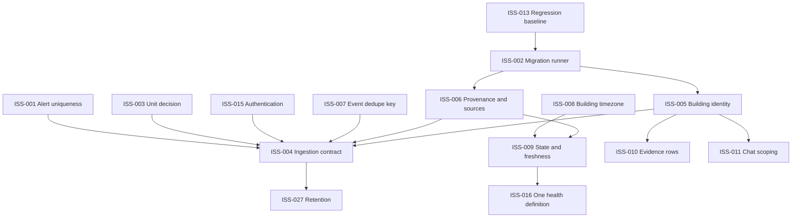

# SPRINT_1_TECHNICAL_ISSUES.md — Anzma AI Insight Core

Prioritised technical issues and dependencies derived from the Day 1 review (`CORE_DATA_ARCHITECTURE.md` findings **F-xx**).
No deadlines, estimates or assignees are given: none are supported by evidence in the repository.

> **Historical snapshot:** this issue list reflects the Day 1 review. For the current schema and migration status, use [DATABASE_BASELINE.md](DATABASE_BASELINE.md); statements below about missing constraints or migration mounts may have been superseded.

| Priority | Meaning |
|---|---|
| **P0** | Critical reliability or data-integrity risk |
| **P1** | Required for the initial productization foundation |
| **P2** | Important improvement |
| **P3** | Future enhancement |

“Phase” refers to migration phases **M0–M6** (`DATA_MIGRATION_PLAN.md` §6) and historian phases **H0–H6** (`HISTORIAN_DESIGN.md` §15).
All code evidence below was read in the uploaded archive; none of it was executed.

---

## 0. Overview

### 0.1 Blockers (must be resolved before connectors or a second building can be onboarded safely)

`ISS-001`, `ISS-002`, `ISS-003` (P0) · `ISS-004`, `ISS-005`, `ISS-006`, `ISS-007`, `ISS-013`, `ISS-015` (P1 foundation)

### 0.2 Improvements (P1/P2 — required for a stable product, not blocking first ingestion)

`ISS-008`, `ISS-009`, `ISS-010`, `ISS-011`, `ISS-012`, `ISS-014` (P1) · `ISS-016` … `ISS-026` (P2)

### 0.3 Future enhancements (P3)

`ISS-027` … `ISS-031`

### 0.4 Dependency map

### 0.5 Decisions needed (Mohsen / Amr)

| ID | Question | Blocks |
|---|---|---|
| Q1 | Canonical unit for `bandwidth_util`: % utilisation or Mbps? | ISS-003 |
| Q2 | IANA time zone and working hours for Main Tower and Data Center Annex | ISS-008 |
| Q3 | Will two customers ever share one database? (RLS vs separate DB/schema) | ISS-005, ISS-011 |
| Q4 | Batch semantics: atomic (as in `docs/API_CONTRACT.md`) or per-record results | ISS-004 |
| Q5 | Are campus/site levels needed beyond `locations.parent_location_id`? | ISS-005 |
| Q6 | Should KPI “Alerts raised” keep counting severity events? | ISS-023 |
| Q7 | Keep the chat read-only SQL tool or restrict to views | ISS-011 |
| Q8 | Who signs off playbook actions (`DEFAULT_APPROVER` placeholder)? | ISS-026 |
| Q9 | Authentication approach for connectors and API; route naming/versioning convention (`/api/v1` is only a proposal in `docs/API_CONTRACT.md`) | ISS-004, ISS-015 |
| Q10 | RPO/RTO and backup destination | ISS-012 |

---

## 1. P0 — Critical reliability / data integrity

### ISS-001 — Alert de-duplication has no database constraint
- **Priority:** P0 · **Phase:** M3 / H5
- **Situation / evidence:** `day2_ahmed/db_adapter.py::store_alerts` inserts with `WHERE NOT EXISTS (rule_id, asset_id, first_ts)`; `alerts` has no `UNIQUE` on those columns (`db/init/anzma_schema_and_seed.sql`). Three writers can run concurrently: the in-process loop `App.py::_alert_loop` (every `DETECT_INTERVAL`=60 s), `POST /alerts/run`, and `POST /alerts`. A second uvicorn worker would start a second loop (`App.py::_startup`). Duplicates would create duplicate incidents (`incident_engine.assign_incidents`).
- **Action:** pre-check for existing duplicates (never delete silently); add `UNIQUE (rule_id, asset_id, first_ts)`; change insert to `ON CONFLICT DO NOTHING`; guard the detection loop with `pg_advisory_lock`.
- **Depends on:** ISS-002 (runner), ISS-013 (baseline).
- **Acceptance:** two concurrent `pipeline.detect()` runs produce no duplicate `(rule_id, asset_id, first_ts)`; `test_day2_integration.py` still 43/43; golden snapshot unchanged; duplicate pre-check query returns 0 rows or each duplicate has a documented resolution.

### ISS-002 — No migration runner or schema versioning; local migration is untracked
- **Priority:** P0 · **Phase:** M1 (prerequisite)
- **Situation / evidence:** `docker-compose.yml` mounts schema, `003`, `004` into `docker-entrypoint-initdb.d`, which runs only on an empty volume. No `schema_migrations` table or runner found. `004_chat_views.sql` is untracked and the compose line that mounts it is staged-only (`git status --short`). Two identical copies of the schema file exist (`db/init/…`, `day2_ahmed/…`; byte-identical).
- **Action:** specify and add a numbered, idempotent migration runner recording applied files in `schema_migrations` (advisory-locked); agree with the owner of the local changes that `004` and the compose change are committed together; choose one canonical location for the schema file. (Docker/compose edits are Amr’s decision; this assignment made none.)
- **Depends on:** coordination with the owner of the staged/untracked files; Amr (deployment).
- **Acceptance:** an existing database at the current state upgrades to the next migration without data loss; a fresh clone builds a database with the same schema as an upgraded one (schema diff empty); applied migrations are listed in `schema_migrations`.

### ISS-003 — Bandwidth unit mismatch silently disables alert rules
- **Priority:** P0 · **Phase:** decision now; fix behind a flag (separate change)
- **Situation / evidence:** seed `metric_types`: `bandwidth_util` unit `'%'`. `alert_config.T`: `bandwidth_warn=900.0`, `bandwidth_crit_mean=980.0`; `alert_engine.rule_net_bandwidth` and `rule_anomaly(... "Mbps")` use them; `db_adapter.METRIC_MAP` labels the value `%`; `integrity_rules.EVENT_CATALOG` says `Mbps`; `alert_config.PLAYBOOKS["NET_LOSS"]` splits causes on `bw_mean_mbps > 900`. Result: `NET_BANDWIDTH_HIGH` and `NET_BANDWIDTH_ANOMALY` cannot fire and `NET_LOSS` always picks `LINK_QUALITY`. Acknowledged in `DAY2_AHMED_HANDOVER.md` (limitation 3) and `README.md`.
- **Action:** decide Q1; register the canonical unit in `metric_types`; make thresholds, labels, `METRIC_MAP`, `EVENT_CATALOG` and facts consistent; document the expected new alerts before enabling.
- **Depends on:** Q1; ISS-013.
- **Acceptance:** a unit test proves a value above the warning threshold in the canonical unit raises `NET_BANDWIDTH_HIGH`; no module labels the metric with a different unit; golden diff lists exactly the approved new alerts.
- **Note:** this is a result-changing fix (`DATA_MIGRATION_PLAN.md` §9.4).

---

## 2. P1 — Initial productization foundation

### ISS-004 — No ingestion path for the canonical contract (telemetry cannot be received)
- **Priority:** P1 (blocker) · **Phase:** M4 / H2
- **Situation / evidence:** `App.py` exposes only `POST /events` (single event) and `POST /alerts`. `README.md` states the `/api/v1` batch ingestion described in `docs/API_CONTRACT.md` is **not implemented**. A search for `INSERT INTO telemetry_records` finds only the seed and `test_frontend_api.py`. The schema comment “1..5000 atomic batch rule enforced in ingestion code” has no matching code.
- **Action:** implement the canonical contract endpoint (telemetry, state, event) per `CANONICAL_DATA_MODEL.md` §16 and `HISTORIAN_DESIGN.md` §3: validation, identity resolution, compatibility, unit/timestamp checks, idempotent persistence, `ingestion_batches`, `ingestion_rejections`; behind a flag; keep `POST /events` working.
- **Depends on:** ISS-002, 005, 006, 007, 015, 001; decisions Q4, Q9, Q1.
- **Acceptance:** contract test matrix (valid, each rejection reason, replay, duplicate, conflict, late, future >5 min) passes; the two-vendor temperature example (`CANONICAL_DATA_MODEL.md` §16.2) yields identical canonical rows apart from asset/source; no change in golden snapshot.

### ISS-005 — Building (and organization) identity missing on operational records
- **Priority:** P1 (blocker) · **Phase:** M1–M3
- **Situation / evidence:** `telemetry_records`, `event_records`, `alerts`, `incidents` have no `building_id`; `frontend_api` passes `"building": None`; only `/dashboard/summary` filters by building (`dashboard_core_pg.SCOPE_CTE`); `db_adapter.load_context` loads all assets; no organization table.
- **Action:** add `organizations`, `buildings.organization_id/building_code`, `assets.building_id`, and `building_id` on facts/alerts/incidents with composite FKs (`CANONICAL_DATA_MODEL.md` §4, §15); backfill; extend repository/views and dashboard/alert/incident endpoints with an optional building filter.
- **Depends on:** ISS-002; decisions Q3, Q5.
- **Acceptance:** zero rows whose `building_id` differs from the building derived via `assets → locations`; each endpoint accepts `building_id` and, with a value, returns only that building’s records; with no value results equal the baseline.

### ISS-006 — Facts lack provenance, observed-vs-received time, and quality
- **Priority:** P1 (blocker) · **Phase:** M1–M3
- **Situation / evidence:** `telemetry_records(telemetry_id, asset_id, metric_id, ts, value)`, `event_records(…, ts, severity, details)`; no source/received/quality columns.
- **Action:** add `data_sources`, `source_id`, `batch_id`, `received_at`, `quality`, `contract_version`, `source_metadata` (nullable first); legacy rows → `legacy-seed`, `quality='GOOD'`, `received_at` NULL; set defaults only after backfill (avoid stamping legacy rows with migration time).
- **Depends on:** ISS-002.
- **Acceptance:** all rows have a `source_id`; `received_at IS NULL` only for legacy rows; content hash of immutable columns unchanged; `v_telemetry_valid` returns the same rows as the base table on current data.

### ISS-007 — Event uniqueness can collapse distinct events
- **Priority:** P1 (blocker) · **Phase:** M3 / H2
- **Situation / evidence:** `event_records UNIQUE (asset_id, event_type_id, ts)`; `POST /events` returns 409 on conflict (`App.py::create_event`).
- **Action:** add `source_event_id` and partial `UNIQUE (source_id, source_event_id)`; keep the legacy key for legacy rows.
- **Depends on:** ISS-006.
- **Acceptance:** two events of the same type on one asset in the same second with different `source_event_id` are both stored; replaying one is a duplicate no-op.

### ISS-013 — No regression baseline harness for KPI/alert/incident/evidence/AI/chat
- **Priority:** P1 (blocker for every change) · **Phase:** M0 / H0
- **Situation / evidence:** tests exist (`test_day2_ahmed.py` 25, `test_day2_integration.py` 43, `test_frontend_api.py`, `test_chat_consistency.py` 31) but no before/after snapshot comparison; seed is data-relative so cross-rebuild comparison is invalid (`db/init/anzma_schema_and_seed.sql`, handover limitation 2).
- **Action:** implement the golden-snapshot capture/compare of `DATA_MIGRATION_PLAN.md` §9.2 against a restored copy; include content hashes (§10).
- **Depends on:** none (needs a restorable backup; ISS-012 provides the procedure).
- **Acceptance:** snapshot taken on a database copy, re-run on the unchanged copy yields an empty diff; deliberately altering one value on the copy is detected.

### ISS-015 — No authentication on API, database port or Socket.IO
- **Priority:** P1 (blocker before real connectors) · **Phase:** before M4 goes live
- **Situation / evidence:** `README.md` limitation “No authentication”; `docker-compose.yml` publishes 5432, 8000, 11434; `App.py` Socket.IO `cors_allowed_origins="*"`.
- **Action:** decide approach (Q9); authenticate connector requests and bind `source_code` to the credential; restrict CORS and DB exposure.
- **Depends on:** Q9; Amr (deployment).
- **Acceptance:** an unauthenticated ingestion request is rejected; a source cannot write for another source’s `source_code`; no secret appears in repository or docs.

### ISS-008 — Hardcoded UTC+2 and 08–18 working hours
- **Priority:** P1 · **Phase:** M5
- **Situation / evidence:** `alert_config.LOCAL_UTC_OFFSET=2`, `WORK_START=8`, `WORK_END=18`; `alert_engine.local_hour/is_occupied`. Affects `after_hours` in `ACC_DOOR_FORCED`, `ACC_DENIAL_SPIKE`, `SEC_BLIND_SPOT_ACCESS`, anomaly regimes.
- **Action:** `buildings.timezone` (validated IANA) + working hours; engine reads them per asset’s building; seed values reproduce current behaviour unless a change is approved.
- **Depends on:** ISS-005; Q2; ISS-013.
- **Acceptance:** with the zone/hours chosen to match the old constants the golden snapshot is unchanged; a building with a different zone classifies the same UTC instant differently in a unit test.

### ISS-009 — Equipment state and data freshness are conflated; no state history
- **Priority:** P1 · **Phase:** M5 / H3
- **Situation / evidence:** `no_data` is a health status (`dashboard_core_pg.STATUS_ORDER`, `_asset_status_counts`); `frontend_api.equipment_health` maps it to `WARNING`; “now” is the latest stored record (`db_adapter.latest_ts`, `v_data_clock`); `reading_gap_min=20` and hourly heartbeat are global (`alert_config.T`, `_heartbeat_compliance`); no state history table.
- **Action:** add `reporting_expectations`, `asset_state_current`, `asset_state_history`, `data_gaps` and the freshness job with the rules in `CANONICAL_DATA_MODEL.md` §8–9; LIVE vs REPLAY evaluation time; shadow-compare against KPI status counts before exposing.
- **Depends on:** ISS-005, 006, 008.
- **Acceptance:** an asset with stale telemetry but no offline event has `freshness=STALE/MISSING` and `availability` unchanged; Camera 2 scenario: KPI `no_data` count unchanged and `freshness=MISSING` reported; shadow comparison shows 0 mismatches or each is explained.

### ISS-010 — Evidence references live only inside JSONB
- **Priority:** P1 · **Phase:** M2 / H5
- **Situation / evidence:** `alerts.evidence` JSON (`alert_engine.evidence_event`: `source`, `record_id`, `event_id|telemetry_id`); `evidence.py::_verify` re-reads rows by id; no FKs.
- **Action:** add `alert_evidence` (FK-backed, `validation_status`, `snapshot`, `telemetry_ts` for future partitioning); dual-write from `store_alerts`; backfill from JSON; keep `evidence.py` reading JSON until parity proven.
- **Depends on:** ISS-005.
- **Acceptance:** per alert, `alert_evidence` row count = number of JSON events; every row resolves to an existing fact row with equal `ts`/`value`; `evidence.alert_evidence()` output unchanged for all alerts.

### ISS-011 — Chat SQL tool is unscoped and guarded by a string blocklist
- **Priority:** P1 · **Phase:** before multi-customer use
- **Situation / evidence:** `app/chat_lite.py::_safe_sql`, `_run_readonly_sql` (staged local file — **do not modify without its owner**): blocklist of tokens, `SET TRANSACTION READ ONLY`, 5 s timeout, `LIMIT 200`, executed on the application connection (`App.day2_connect`, user from env; compose default `postgres`). No building scope.
- **Action:** dedicated read-only DB role limited to `v_*` views; building-scoped views; decide whether the free-form tool remains (Q7); coordinate with the owner of the local changes.
- **Depends on:** ISS-005; Q3, Q7.
- **Acceptance:** the chat role cannot read base tables or write; a query under building A cannot return building B rows; `test_chat_consistency.py` still 31/31.

### ISS-012 — No backup, restore or integrity-verification procedure
- **Priority:** P1 · **Phase:** H0 / H6
- **Situation / evidence:** none found in the repository; data lives in named volume `pgdata` (`docker-compose.yml`).
- **Action:** scheduled `pg_dump` to storage outside the volume; restore runbook into a scratch DB; integrity script reusing `integrity_rules.stored_violations` and `evidence.alert_evidence`, plus counts/hashes/orphan checks (`HISTORIAN_DESIGN.md` §13).
- **Depends on:** Q10.
- **Acceptance:** restore drill into a scratch database reproduces table counts and content hashes; integrity script reports `{'telemetry': 0, 'events': 0}` and `unverified = 0`.

### ISS-014 — Competing model documents obscure the authoritative model
- **Priority:** P1 · **Phase:** documentation (no code)
- **Situation / evidence:** `DATA_MODEL.md`, `data-model.sql`, `ERD-new.png`, `day2_ahmed/NEW-ERD.png` describe a 22-table schema not deployed; `DATA_MODEL.md` cites missing `migrations/001_unified_schema.sql`; `docs/ARCHITECTURE.md`/`docs/API_CONTRACT.md` describe unimplemented components; `DAY2_AHMED_HANDOVER.md` states D2 (authoritative = `anzma_schema_and_seed.sql` + `003`).
- **Action:** after review, mark those files “superseded draft” with a pointer to this document set; reuse their ideas (timezone, `zone_type`, `resolves_event_type_id`, `asset_state`, `evidence`) as already incorporated. (Day 1 modifies none of them.)
- **Depends on:** team approval of these documents.
- **Acceptance:** each superseded file starts with a banner naming the authoritative documents; the README links `CORE_DATA_ARCHITECTURE.md` as the data-model reference.

---

## 3. P2 — Important improvements

### ISS-016 — Asset health is implemented four times
- **Priority:** P2 · **Phase:** M6
- **Evidence:** `app/dashboard_core_pg.py::_asset_status_counts`; `app/frontend_api.py::equipment_health`; `004_chat_views.sql::v_asset_overview`; `app/chat_facts.py::_conditions/_status`. `v_asset_overview` uses window `(as_of−24h, as_of]` and counts any critical event, while the KPI uses `[start,end)` and excludes recovered paired faults.
- **Action:** compare outputs on current data; choose one definition; implement once (repository/view); other paths call it.
- **Depends on:** ISS-009, ISS-013.
- **Acceptance:** parity test across KPI, equipment-health, chat for every system and building; any approved difference is listed.

### ISS-017 — Fault/recovery pairs and event compatibility are duplicated
- **Priority:** P2 · **Phase:** M6
- **Evidence:** `FAULT_RECOVERY_PAIRS` (`dashboard_core_pg.py`), `CLOSERS` (`integrity_rules.py`), pair logic in `v_camera_status`; `EVENT_CATALOG` (`integrity_rules.py`) vs `event_type_system_compat`; `hvac_fault/hvac_recovered` in KPI pairs but unmapped in `db_adapter.EVENT_MAP`.
- **Action:** `event_types.event_class` + `resolves_event_type_id`; single DB source; retire Python copies.
- **Depends on:** ISS-016.
- **Acceptance:** KPI and chat results equal baseline; one definition remains.

### ISS-018 — Catalogues and zone semantics are hardcoded
- **Priority:** P2 · **Phase:** M1 / M5
- **Evidence:** `system_types.code CHECK (…)`; `reference_data.SYSTEM_CODES`; `'Server Room'` in `alert_engine.py` (rule_hvac_temp, rule_cctv) and `chat_lite.py`; `v_camera_status` uses `asset_type='camera'`.
- **Action:** drop CHECK; read systems from table; `locations.zone_type/is_sensitive`; flag the existing Server Room.
- **Depends on:** ISS-005.
- **Acceptance:** adding a system type is an `INSERT` only; identical alerts for the existing data; no `"Server Room"` literal in engine code.

### ISS-019 — Three connection factories, two drivers, weak defaults
- **Priority:** P2 · **Phase:** M6
- **Evidence:** `db_adapter.connect` (psycopg2/psycopg), `App.day2_connect` (psycopg2, default password `""`), `dashboard_core_pg.open_readonly` (psycopg v3, default password `"change-me"`, not actually read-only).
- **Action:** one connection module; read paths use a read-only role; required env credentials; optional pooling.
- **Depends on:** ISS-011.
- **Acceptance:** one factory used by all modules; read endpoints run under a role without write privileges; startup fails if credentials are missing.

### ISS-020 — Dead and legacy code
- **Priority:** P2 · **Phase:** M6
- **Evidence:** `dashboard_api.py`, `chat_engine.py`, `chat_api.py` (old schema; only imported by each other); `alert_engine.load_context`/`store_alerts(cur, alerts, start, end)` reference non-existent `systems`/`events` tables and the latter runs `DELETE FROM alerts …`; `scenario_runs` unreferenced.
- **Action:** remove after confirming no importers and tests pass.
- **Depends on:** ISS-013.
- **Acceptance:** repository search shows no references; all suites pass.

### ISS-021 — Alert timestamps and alert-level lifecycle
- **Priority:** P2 · **Phase:** M3
- **Evidence:** `alert_engine.make_alert` sets `detected_ts` to the first data timestamp for threshold rules; `created_at` is processing time; only incident-level status endpoint exists (`POST /incidents/{id}/status`); no acknowledged/resolved actor fields.
- **Action:** add `detected_at`, `acknowledged_ts/by`, `resolved_by`; define single-alert acknowledge/resolve API consistent with incident cascade.
- **Depends on:** ISS-005.
- **Acceptance:** lifecycle tests keep passing (`TEST_RESULTS_DAY2.txt` lifecycle checks); new fields populated on transitions.

### ISS-022 — Dormant rules and unmapped catalogue entries
- **Priority:** P2 · **Phase:** documentation → M4
- **Evidence:** rules needing `FILTER_FAULT`, `MOTION_DETECTED`, `BATTERY_LOW`, `PANEL_HEARTBEAT`, `ACCESS_GRANTED`, `fan_on`/`mains_ok`/`battery_pct` detail keys; seed `event_types` lacks them; `EVENT_MAP` maps 9 of 12 seeded types (`HVAC_FILTER_FAULT`, `CCTV_AFTER_HOURS_MOTION`, `FIRE_BATTERY_LOW` cannot fire).
- **Action:** document as dormant; add the types/metrics when a real source provides them; make mapping table-driven.
- **Depends on:** ISS-017.
- **Acceptance:** a rule/data-requirements table exists; adding the missing event type and a test event triggers the rule.

### ISS-023 — Two meanings of “alert”
- **Priority:** P2 · **Phase:** decision Q6
- **Evidence:** `dashboard_core_pg._alert_counts` counts `event_records` severity; `alerts` table is separate; UI label “Alerts raised” (`frontend_api.overview`).
- **Action:** keep KPI values; clarify labels/definitions; add alert-based KPIs separately if wanted.
- **Depends on:** Q6.
- **Acceptance:** KPI output unchanged; definitions text states what is counted.

### ISS-024 — Heartbeat compliance assumes hourly cadence
- **Priority:** P2 · **Phase:** M5
- **Evidence:** `_heartbeat_compliance`: `expected_slots = seconds // 3600 + 1`.
- **Action:** compute expected from `reporting_expectations`; default 3600 s reproduces current numbers.
- **Depends on:** ISS-009.
- **Acceptance:** identical KPI on current data; correct result for an asset with a different interval in a unit test.

### ISS-025 — Archive/secret hygiene and CORS
- **Priority:** P2 · **Phase:** immediate hygiene
- **Evidence:** a `.env` file was present in the uploaded ZIP (git-ignored, untracked; contents not read); `__MACOSX`, `.DS_Store`, `__pycache__` in the archive; `cors_allowed_origins="*"`.
- **Action:** exclude `.env` and OS artefacts from hand-off archives; document required variables in `.env.example` only.
- **Acceptance:** archive checklist exists; no credentials in any document.

### ISS-026 — Playbook approvals are placeholders
- **Priority:** P2 · **Phase:** content
- **Evidence:** `alert_config.DEFAULT_APPROVER`; handover limitation 6; `README.md` (only HVAC approval reported).
- **Action:** named approvers per playbook (Q8); store approval records.
- **Acceptance:** each approved action has a real approver; recommendations unchanged otherwise.

---

## 4. P3 — Future enhancements

| ID | Title | Evidence / trigger | Action | Acceptance |
|---|---|---|---|---|
| ISS-027 | Retention policy framework | None in repo (`HISTORIAN_DESIGN.md` §10) | `retention_policies` table, bounded-batch job, **disabled by default**, durations approved by business | With policy disabled nothing is deleted; enabled policy deletes only eligible rows and logs a summary |
| ISS-028 | Rollup tables (`telemetry_rollup_1h/1d`) | Add only after measured latency need (`HISTORIAN_DESIGN.md` §8) | Idempotent rollup job incl. late-data reopen | Rollup equals raw aggregate for closed buckets |
| ISS-029 | Partitioning readiness | PK/FK constraint with partitioned tables (`HISTORIAN_DESIGN.md` §14) | Keep `telemetry_ts` in `alert_evidence`; rehearse partitioned copy | Rehearsal restores and passes integrity checks |
| ISS-030 | Move `scenario_runs` to an `eval` schema | Test harness in `public` schema (F-28) | Relocate; engine must not read it | No production query references it |
| ISS-031 | Connection pooling | Per-request connections (F-21) | Pool in the consolidated connection module | Connection count bounded under load test |

---

## 5. Out of scope for Sprint 1 (per assignment)

New vendor SDKs, Milestone or KNX integrations, new AI features, replacing the KPI/alert/incident/AI engines, TimescaleDB/Kafka/Redis, Docker configuration changes (by this assignment), dependency changes.
